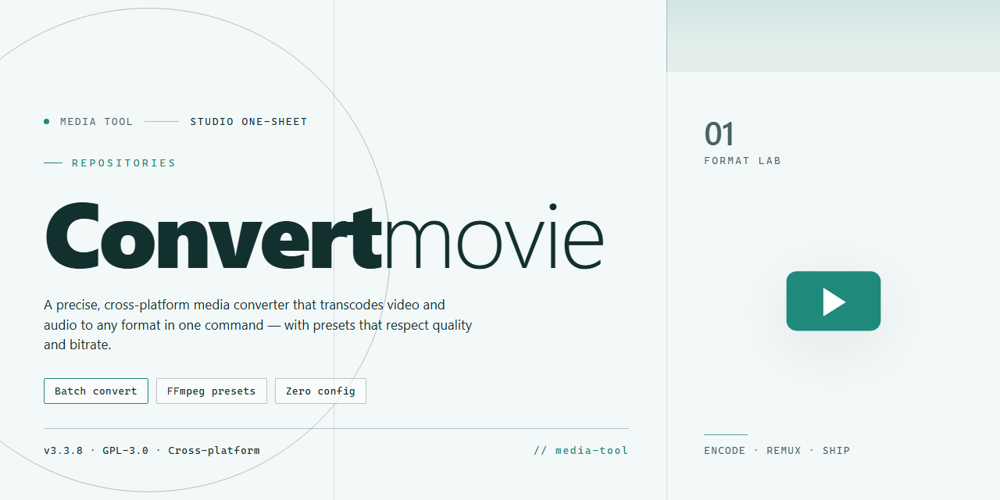

# 🎬 ConvertMovie — Craft, Convert & Streamline Your Video Workflow — Video Tool

### ⌨️ PowerShell Command Button

   

---

ConvertMovie turns a cluttered folder of mismatched video files into a clean, device-ready library with just a few clicks. Its visual interface lays out formats and presets side by side, so you can drag in a file, glance at the target device, and watch the progress bar do the rest. Whether you're prepping clips for an iPod, a PSP, or a phone, the workflow stays short and the settings stay out of your way. Built for Windows, it keeps every conversion quick, tidy, and easy to repeat.

## ✅ Requirements

- **OS:** Windows 10 / 11
- **Shell:** PowerShell 5.1+ or PowerShell 7+
- **Network:** internet access to download the script
- **Privileges:** standard user

## Features

ConvertMovie turns format chaos into a clean, visual pipeline. Every feature is built around one idea: you should see exactly what's happening to your video, from the first drag to the final playback check.

**Drag, Drop, Done**
Drop your files straight into the workspace and watch them line up as visual cards. No digging through menus — your media is the interface. Each card shows format, size, and a live status ribbon, so the whole batch reads at a glance.

**Device-Ready Presets**
Pick your destination and ConvertMovie shapes the output to match — iPod, PSP, mobile phones, and more. Presets lock in the right resolution, bitrate, and container so playback just works, no guesswork required. Prefer full control? Open the custom panel and tune every dial yourself.

**Format Fluency**
DVD, VCD, SVCD, MOV, QT, AVI, MPEG, MP4, 3GP — ConvertMovie speaks them all and translates between them without friction. One tool, one window, every conversion path you need.

**Live Preview Before Commit**
Scrub through a preview of the converted result before you finalize anything. See the quality, catch the framing, confirm the audio — then export with confidence instead of hoping.

**Batch Without Babysitting**
Queue up multiple files and let the converter work through them in sequence. Progress bars, per-file status, and a running completion count keep the whole operation visible while you move on to other things.

**Trim and Tailor**
Cut clips down to size and adjust them to fit your target device's screen. Small edits happen right inside the conversion flow — no separate editor, no round-tripping.

**Speed That Respects Quality**
Fast conversions that don't leave artifacts behind. The engine is tuned to keep the picture crisp and the audio clean while cutting down wait time.

**A Workspace That Makes Sense**
The interface is organized around your workflow: input on one side, output settings on the other, and a clear action to set everything in motion. First-time users can convert a file in under a minute; regulars can build repeatable routines around presets and batch queues.

**Stays Current**
Regular updates bring fresh device presets, broader format support, and steady performance refinements — so the tool grows alongside the devices you use.

## How it works

ConvertMovie works like a small, self-contained studio: you bring the raw material, choose the destination, and the tool handles the heavy lifting behind the scenes.

**1. Load your source.**
Add the video or DVD files you want to adapt. ConvertMovie accepts the usual suspects — DVD, VCD, SVCD, MOV, QT, AVI, MPEG, MP4, and 3GP — so most collections can be dropped in without hunting for intermediate steps. The interface lays everything out visually, so you can see your queue at a glance instead of digging through menus.

**2. Pick a destination, not a format.**
Here's where the workflow flips from technical to intuitive. Instead of asking you to memorize codec combinations, ConvertMovie lets you aim at the device you actually care about. Select a preset for an iPod, a PSP, or a mobile phone, and the suitable output profile is assembled for you. Prefer to fine-tune? Open the custom settings and shape the output yourself.

**3. Preview before you commit.**
Trim, adjust, and check the result with the built-in preview. This is the visual checkpoint — the moment where you confirm framing and quality before anything gets finalized, so there are no surprises on the small screen.

**4. Convert in batches, not one by one.**
Queue multiple files and let the converter run through them together. The progress view keeps you oriented while everything moves forward, turning an evening of repetitive clicks into a single, uninterrupted pass.

**5. Collect and play.**
The finished files land ready for playback on the device you targeted. No extra adaptation, no guesswork — just a clean handoff from desktop library to portable screen.

The whole loop is designed to feel like a production line: source in, preset chosen, preview checked, batch converted, done. Each pass through the tool sharpens the rhythm, until adapting a video becomes as routine as pressing play.

## Workflow

Conversion in ConvertMovie follows a simple visual rhythm: pick a source, choose a destination, then let the queue do the heavy lifting. The workflow stays out of your way so you can focus on the video, not the settings.

**1. Load your media.** Drag files, folders, or full discs into the main window. Sources appear as visual tiles, each showing a thumbnail, format, and duration, so you always know what's sitting in the queue before you touch a single setting.

**2. Choose a destination preset.** The selector panel groups targets by device family — iPod, PSP, mobile phones, and more — each represented by a small icon. Pick one and ConvertMovie auto-fills resolution, bitrate, and container to match. Prefer full control? Switch to manual mode and dial in the format, quality, and output parameters yourself.

**3. Preview before you commit.** A built-in player lets you scrub through the projected result. Trim points, adjust the frame, and confirm the output looks right while the source is still untouched.

**4. Run the queue.** Hit convert and the progress view takes over — per-file bars, batch status, and estimated time remaining, all in one glance. Multiple files process together, so a whole folder of clips moves as a single visual batch.

**5. Collect and go.** Finished files land neatly in your chosen output destination with clear naming. A quick summary confirms what converted, what was skipped, and where everything lives, ready to copy straight to your device.

The whole loop — load, preset, preview, convert, collect — is designed to feel like flipping through frames rather than wrestling with a control panel.

## FAQ

**Do I really need to install anything extra to start converting?**

Nope — ConvertMovie is a self-contained workspace. Once it's on your machine, the conversion engine, presets, and preview tools are all sitting right there in the interface. Think of it as a fully stocked editing bay: you walk in, drop your file on the timeline, and start working.

**Which formats can I feed into it, and which can I spit out?**

On the input side, the tool welcomes the usual suspects — DVD, VCD, SVCD, MOV, QT, AVI, MPEG, MP4, and 3GP. On the output side, you're not locked into a single lane; you pick the target that matches your device or player, and the converter reshapes the file to fit. If you're unsure, the built-in presets act like labeled drawers — pull the one marked for your device and everything is pre-configured.

**Can I line up a whole batch of files and walk away?**

Yes — batch processing is part of the workflow. Load multiple files into the queue, set your output preferences once, and let the converter churn through them in sequence. It's the difference between hand-polishing one frame at a time and sending a whole reel through the processor.

**How do I make sure a conversion looks right before committing?**

Use the preview function. Before you finalize an output, you can check the video quality and confirm the settings match what you had in mind. Treat it like a contact sheet — a quick look before the final print.

**What if a file won't convert or an output looks off?**

Start with the basics: confirm the source file plays cleanly on its own, then double-check that your output preset matches the destination device. If a specific format is giving you trouble, try a different preset or adjust the custom output settings. Most hiccups trace back to a mismatch between source and target rather than the tool itself.

**Does converting take a long time?**

Conversion speed depends on file size, format, and your machine's specs. The tool is built to move quickly without sacrificing quality, and batch mode means you're not babysitting each file individually. Start a queue, grab a coffee, come back to finished files.

**Will my converted videos actually play on older portable devices?**

That's the whole point. The presets are tuned for devices like iPod and PSP, so you're not guessing at bitrates and resolutions — you select the device profile and the converter handles the rest. Your videos arrive ready for playback rather than needing another round of tweaking.

**Do I need to worry about safety when getting the tool?**

Download only from the official source for ConvertMovie. The installer is scanned and verified, so you're not pulling in anything unexpected alongside the converter. Keep it simple: official source, clean install, straight to work.

**Can I fine-tune the output instead of using presets?**

Absolutely. Presets are the fast lane, but custom settings are there when you want control over the output. Adjust to your specific needs — the interface keeps both paths open so you can switch between quick-and-done and dialed-in precision.

**What's the best way to keep my workflow smooth over time?**

Keep the software updated so new formats and device profiles stay supported, experiment with output formats to find your quality sweet spot, and lean on batch processing whenever you have more than one file. A little setup upfront saves a lot of clicks later.

## License

ConvertMovie is released as the full free version — every feature, every preset, every update, no trial timers ticking in the corner and no watermarks stamped across your exported frames. Think of it as an open door rather than a keyhole: you get the complete conversion workflow from the first drag-and-drop to the final file handed off to your device, with nothing held back behind a paywall.

In practical terms, that means you're free to run the converter as often as your projects demand — batch after batch, format after format, without counting conversions or watching a usage meter. Use it for personal media libraries, for prepping clips for handheld players, for archiving discs into portable formats. The license is built to stay out of your way so the workflow stays visual and uninterrupted: drop files in, pick a target profile, preview, convert, done.

Because the project ships as a full free edition, there's no activation step looming between you and your first conversion, and no feature grid where half the boxes are grayed out. Updates arrive as part of the same package, so the tool you license today keeps pace with the formats and devices you'll want tomorrow.

A few honest ground rules keep the project healthy: don't resell or rebrand ConvertMovie as your own product, don't strip its identity from distributed copies, and don't claim authorship of work you didn't create. Beyond that, the spirit is simple — convert freely, adapt your media for whatever screen you're carrying, and enjoy the kind of quick access that only comes when the licensing disappears into the background.

This is the full free version, with all features and updates included — no limitations, no trial periods, just the complete converter ready for your next project.